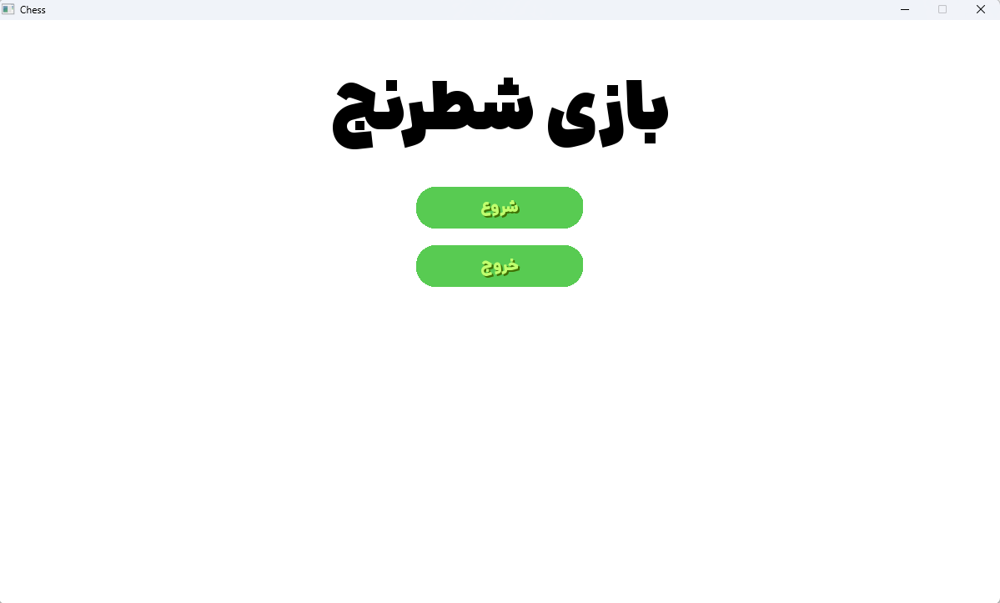
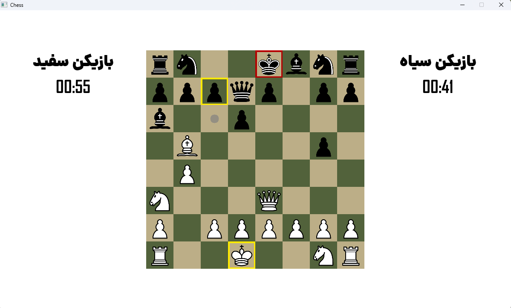

# ChessWithC
Just a project from university. That I made a chess game with C language and SDL3 library. I tried my best to not using built-in functions for drawing buttons and texts on the gui surface. 

There is some diffrent rules for moving of any piece on the surface. but the check and checkmate rules are the same.


---
##The Code
> I define a **"surface"** as a grid with a specific number of rows and columns—essentially a graphical rectangle—where the color of a pixel is assigned to each cell.

Since the application's main surface needs to be rendered continuously, I defined a `while` loop in `gui.c` where I recreated and re-initialized the surface during each iteration.
However, in reality, the surface did not need to be rendered at every single moment; the number of renders per second depends on the monitor's current refresh rate.
For instance, if my monitor has a 60Hz refresh rate but the application performs 800 renders per second, approximately 740 of those rendered frames are never displayed, effectively placing an unnecessary load on system resources.
To prevent these redundant renders, I calculated the timeout duration within the `while` loop based on the target refresh rate.
```
    SDL_Delay(1000 / refresh_rate);
```
> The refresh rate is obtained from main.c.
---
I wrote a set of functions to place one surface onto another, or to merge two surfaces—specifically handling cases where parts of the surface being placed are transparent.

###Merging two surfaces (source and destination surfaces)
```
uint32_t alpha_blend(uint32_t src, uint32_t dst) {
  uint8_t sa = src >> 24;
  if (sa == 255)
    return src;
  if (sa == 0)
    return dst;

  uint8_t sr = (src >> 16) & 0xFF;
  uint8_t sg = (src >> 8) & 0xFF;
  uint8_t sb = src & 0xFF;

  uint8_t dr = (dst >> 16) & 0xFF;
  uint8_t dg = (dst >> 8) & 0xFF;
  uint8_t db = dst & 0xFF;

  uint8_t r = (sr * sa + dr * (255 - sa)) / 255;
  uint8_t g = (sg * sa + dg * (255 - sa)) / 255;
  uint8_t b = (sb * sa + db * (255 - sa)) / 255;

  return (0xFF << 24) | (r << 16) | (g << 8) | b;
}
```

###Placing one surface onto another

> Logically, the dimensions—both length and width—of the source surface must be smaller than those of the destination surface. Since I adhered to this requirement, I did not implement error handling.
```
void put_surface(uint32_t *dest, int dw, int dh, SDL_Surface *src, int px,
                 int py, int pw, int ph) {
  uint32_t *sp = (uint32_t *)src->pixels;

  float wnesbat = (float)pw / (float)src->w;
  float hnesbat = (float)ph / (float)src->h;
  for (int y = 0; y < ph; y++) {
    for (int x = 0; x < pw; x++) {
      int dx = px + x;
      int dy = py + y;

      if (dx < 0 || dy < 0 || dx >= dw || dy >= dh)
        continue;

      uint32_t p = sp[(int)(y / hnesbat) * src->w + (int)(x / wnesbat)];
      uint8_t a = p >> 24;
      if (a) {
        uint32_t *d = &dest[dy * dw + dx];
        *d = alpha_blend(p, *d);
      }
    }
  }
}
```
---
The core of the program resides in `chess_logic.c`, which defines the game's primary logic—handling tasks such as defining the pieces, calculating legal moves, and determining check and checkmate conditions.

When calculating legal moves, I first needed to determine the total set of possible moves for a given piece. Since a move must not expose the player's own king to check, I simulated each potential move to verify whether the king would be left in check as a result.

###Regular moves
```
void get_regular_moves(uint8_t *moves, Piece *piece) {
  uint8_t *raw_moves = malloc(sizeof(uint8_t) * 64 * 3);
  for (int i = 0; i < 63; i++)
    moves[i] = 8;
  int moves_count = 0;
  get_moves(raw_moves, piece);
  for (int i = 0; raw_moves[i] < 8; i += 3) {
    if (!simulate_move_and_check(piece, raw_moves[i], raw_moves[i + 1])) {
      moves[moves_count * 3] = raw_moves[i];
      moves[moves_count * 3 + 1] = raw_moves[i + 1];
      moves[moves_count * 3 + 2] = raw_moves[i + 2];
      moves_count++;
    }
  }
  free(raw_moves);
}
```

###Simulating movement of a piece
```
int simulate_move_and_check(Piece *piece, int x, int y) {
  int is_piece_removed = 0;
  Piece *removed_piece;
  for (int i = 0; i < 32; i++) {
    if (!pieces[i].is_removed && pieces[i].x == x && pieces[i].y == y &&
        pieces[i].color != piece->color) {
      removed_piece = &pieces[i];
      is_piece_removed = 1;
      pieces[i].is_removed = 1;
    }
  }
  int fx = piece->x, fy = piece->y;
  piece->x = x;
  piece->y = y;
  int ic = is_check(piece->color);
  piece->x = fx;
  piece->y = fy;
  if (is_piece_removed) {
    removed_piece->is_removed = 0;
  }
  return ic;
}
```
